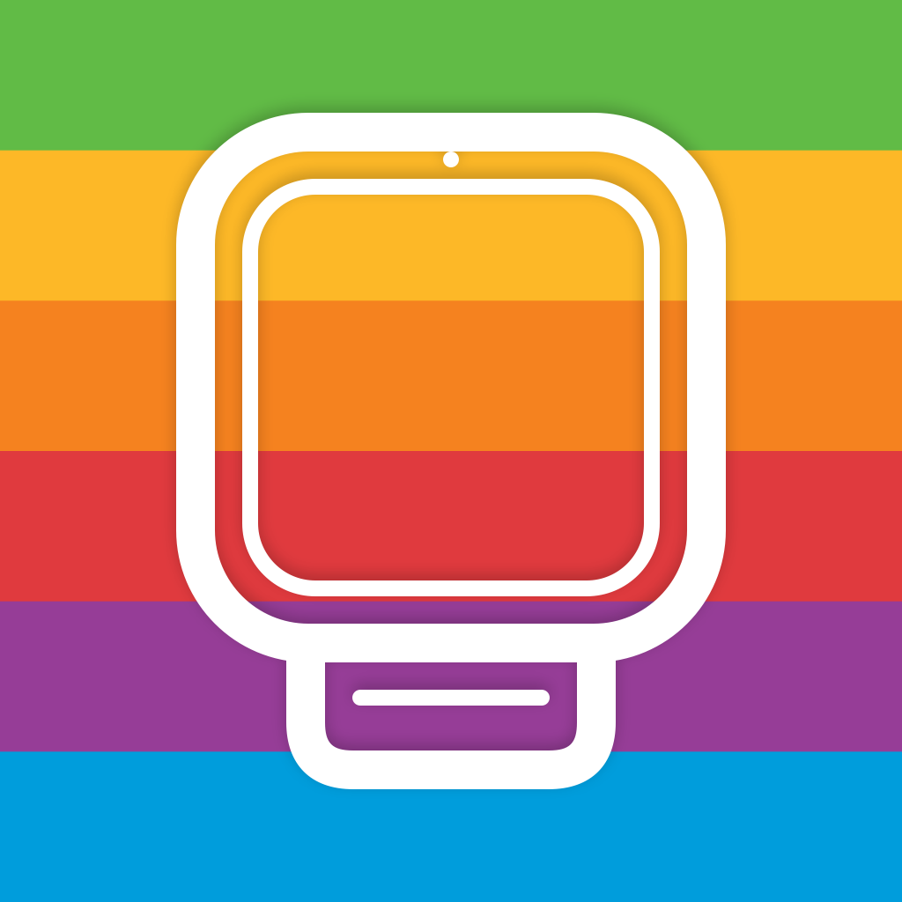
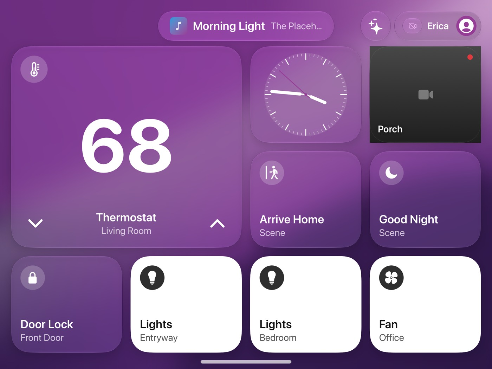
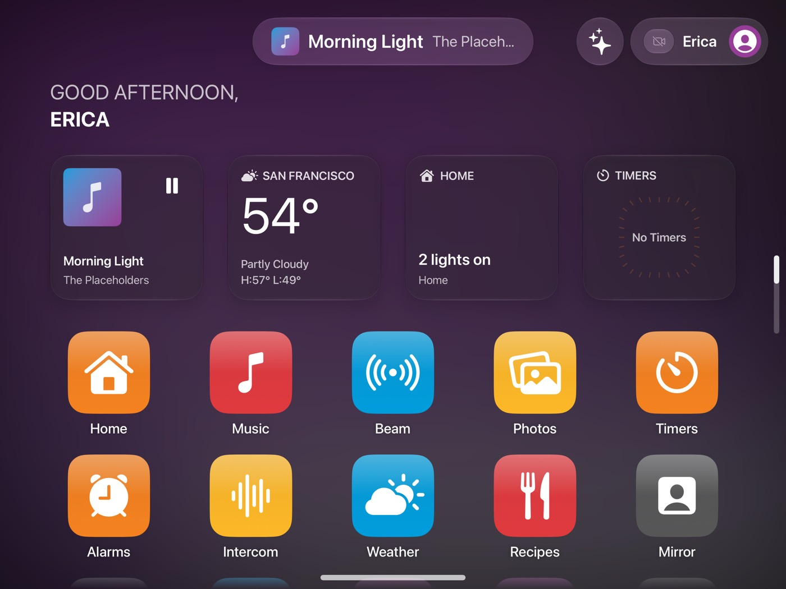
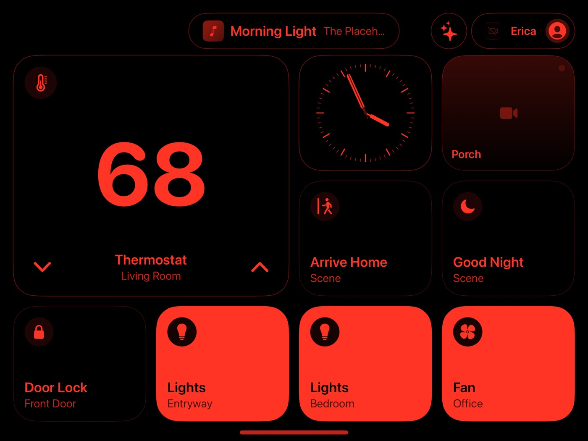
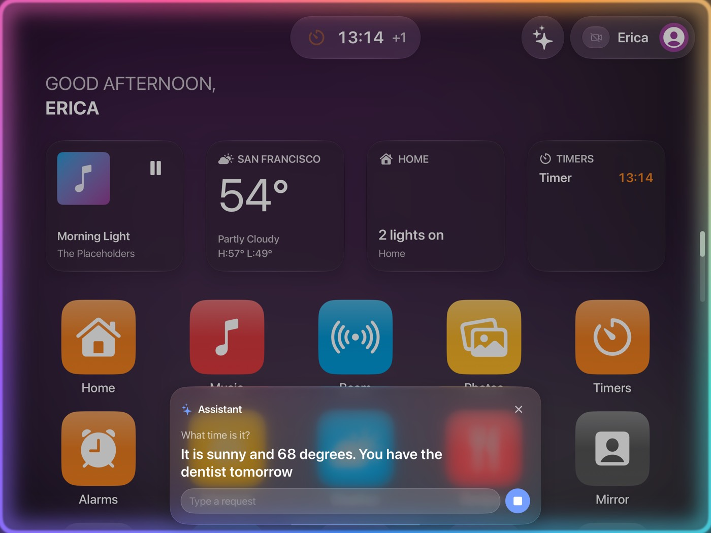
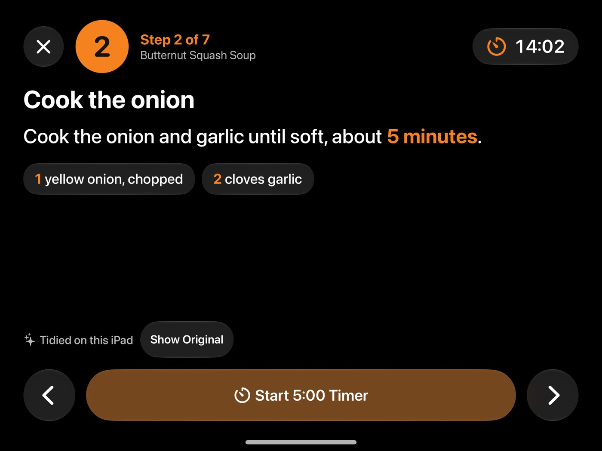
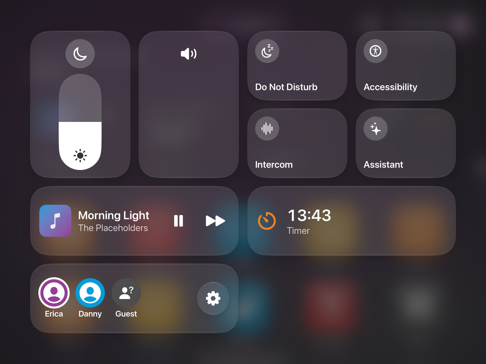

<h1 align="center">
  
  <br />
  HomePad
</h1>

<p align="center"><em>The iPad on your counter, turned into the home's screen.</em></p>

**HomePad** turns an iPad into a shared home display modeled on Apple HomeView. The iPad is the
**hub**. It shows faces, the home's controls, timers, and music to anyone in the room, and it shows
personal things only to the household member it recognizes. Each member's iPhone runs the same app
as a **companion** that pairs with the hub and beams pages to it.

HomeView has a square screen. An iPad does not, so HomePad fills the whole rectangle instead of
drawing a square in the middle of it. It looks better this way, though I am biased.

HomePad is not an Apple product and is not affiliated with Apple.

## Screens

These captures come from the iPad Pro 13-inch simulator with sample data.

<table>
  <tr>
    <td width="33%"></td>
    <td width="33%"></td>
    <td width="33%"></td>
  </tr>
  <tr>
    <td><strong>Home Modular</strong><br />The home's controls as glass tiles. A tap switches a tile, a long press opens a dimmer.</td>
    <td><strong>Home Screen</strong><br />Widgets and apps for the person the hub recognizes.</td>
    <td><strong>Night Mode</strong><br />Red on black, with the screen dimmed, when the room is dark.</td>
  </tr>
  <tr>
    <td></td>
    <td></td>
    <td></td>
  </tr>
  <tr>
    <td><strong>Assistant</strong><br />Answers from the model on the device. It is not Siri.</td>
    <td><strong>Recipes</strong><br />A beamed recipe, tidied into short steps and checked against the page.</td>
    <td><strong>Control center</strong><br />Swipe down from the top right.</td>
  </tr>
</table>

## Requirements

| | |
|---|---|
| Hub | An iPad on iPadOS 27 or later |
| Companion | An iPhone on iOS 27 or later |
| Apple Intelligence | Supported and turned on. HomePad shows a blocking screen until it is |
| Unlocking personal content by face | An iPad with a TrueDepth camera. On other iPads the camera picks the person and Touch ID confirms |
| Kiosk lock | A supervised iPad. Any other iPad uses Guided Access |
| Building | Xcode 27.2, [XcodeGen](https://github.com/yonaskolb/XcodeGen), and an Apple developer team with the App Groups, HomeKit, Group Activities, and WeatherKit capabilities |

HomePad runs on iPhone and iPad only. Nothing in it builds for or runs on macOS.

## How the hub decides what to show

The hub looks at two things before it draws anything: how far away you are, and who you are.

### Distance

| Zone | About | What you see |
|---|---|---|
| Far | more than 2.5 m | Large numbers only: the time, the temperature, the weather |
| Mid | 1.0 m to 2.5 m | Labels, room names, and camera thumbnails fade in |
| Near | less than 1.0 m | Full controls, with touch targets of at least 44 points |

Distance comes from the TrueDepth camera when the iPad has one. Otherwise HomePad estimates it
from the size of your face in the frame. Both are estimates, and `Detail Distance` in Settings
moves the boundaries.

### Who is in front

| Who | What the hub shows |
|---|---|
| Nobody, or a guest | Shared things: faces, timers, music, weather, and the home's controls. No scenes, and no unlocking a door |
| A member, picked by hand or matched without proof of a live face | Their layout and accent color. Personal apps are listed with a lock |
| A member recognized by a live face match | Everything of theirs: Calendar and Reminders from their iPhone, their browser pages, and scenes |

When the camera loses you, you stay signed in for a grace period (2 minutes unless you change
it). Your pages stay on screen, so a turned head in the kitchen does not close them. Personal
content locks at once. The grace period ends early when someone else's face appears, when another
member is recognized, or when the hub is locked.

### Night Mode

When the room is dark, or on a schedule, everything turns red on black and the screen dims.
HomePad cannot read the iPad's light sensor, so it estimates the room's brightness from the
camera's exposure. The estimate has to hold for 8 seconds before the hub switches, so a passing
shadow does not flip it.

## Faces

Swipe left or right to change the face. Press and hold for the face picker. `Customize` in the
picker opens HomePad's page in the Settings app.

| Face | Shows |
|---|---|
| Home Modular | The thermostat, a clock, a camera, scenes, and accessory tiles |
| Modular | Large widgets with no backgrounds, on black |
| Home Camera | One, four, or nine camera feeds. Tap one to fill the screen |
| Analog, Digital | Clocks, with a choice of numerals, fonts, and colors |
| Fade | A dial whose hour numerals fade in and out as the hand passes |
| Flow | A moving gradient that reacts to where you stand |
| Photos, Memories | Full-screen photos, with the time behind the person when one is found |
| Weather | A drawn sky that follows the conditions, the temperature, and a precipitation bar |
| Calendar | The date and month |
| Rainbow | Six stripes in rainbow order, with the time on top |

## Home Screen and apps

Swipe up from the bottom edge for the Home Screen. It has a row of widgets and a grid of apps:
Home, Music, Beam, Photos, Timers, Alarms, Intercom, Weather, Recipes, Mirror, Clock, iPhone Apps,
and Settings. Calendar appears while a member's iPhone supplies it. People and Pairing appear
while Setup Mode is on.

A pill at the top of each face carries what is live: a running timer, what is playing, a household
note, a page waiting for you, and a short confirmation when the hub recognizes someone. Tap it to
expand it.

The control center is a swipe down from the top right. The Assistant is a swipe down from the top
center, or its button beside the profile.

## Face recognition

Vision finds and aligns the face. A bundled Core ML model (SFace, from the OpenCV Model Zoo) turns
it into a vector, and HomePad compares that vector with the ones each member enrolled. The
TrueDepth camera's depth data rejects a photo held up to the camera.

- Images never leave the iPad and are never saved. Only the enrolled vectors are kept, in the
  Keychain, on that device.
- This is personalization, not Face ID. It does not run in the Secure Enclave.
- Touch ID cannot tell household members apart. On an iPad without TrueDepth, the camera picks
  the person and a fingerprint confirms that someone enrolled on the iPad is present.
- Center Stage is turned off for the recognition camera, because its cropping breaks the distance
  estimate.

More in [docs/FACE_RECOGNITION.md](docs/FACE_RECOGNITION.md) and
[docs/FACE_MODEL.md](docs/FACE_MODEL.md).

## Beam

Beam puts a web page from your iPhone on the hub.

| Way | How |
|---|---|
| Share sheet | Share a page to HomePad from Safari or any app on a paired iPhone |
| SharePlay | Browse the same page together in a session the hub is part of |
| Handoff | Pick up the page on the hub, when both devices use the same Apple Account |
| iMessage | The HomePad app in Messages inserts an "Open on HomePad" card. You tap Send |
| Siri | "Beam a page to HomePad" |

Pairing happens once per iPhone. The hub shows a QR code and the iPhone scans it. The two then
talk over an encrypted link on your home network, with a key that only those two devices hold.

### A browser for each person

Every page you beam opens in a browser that belongs to you.

- You can have up to 6 pages open, with a switcher to move between them.
- A page opens only while the hub sees you. If someone else is in front, it waits for up to 30
  minutes and shows them nothing, not even its title. Your iPhone says it is waiting for you.
- When you leave, every page of yours closes. A guest's recent pages are forgotten too.
- Sign-ins are kept only for a member whose face unlocked personal content.

The browser is locked to the app. It has no address bar, share button, downloads, or file
pickers. It refuses other apps, camera and microphone requests, location requests, pop-up
dialogs, Picture in Picture, and the long-press menu on links and images. `Send to iPhone` stays.

It is a web view inside HomePad, not Safari. An app cannot lock Safari down or close its tabs.

More in [docs/BEAM.md](docs/BEAM.md).

## Recipes

A beamed recipe opens in the recipe reader: a cover, an ingredient checklist, and one step at a
time in large type, with a timer pill that stays on screen.

The model on the device then tidies the recipe into short titled steps and lists the ingredients
each step uses. A wrong amount ruins dinner, so nothing the model writes is shown until it passes
these checks against the page:

- Every amount, temperature, and time appears in the page, in the same order.
- No ingredient is added, and none is lost.
- No step is dropped or moved.

A line or step that fails keeps the page's own wording. If fewer than half the steps pass, the
tidied version is thrown away. `Show Original` switches back at any time, and `Tidy Up Recipes` in
Settings turns the feature off.

The page text goes to a model session that has no access to the hub's actions. Thus, a web page
cannot make the hub do anything.

## Assistant

The Assistant answers questions and runs hub actions with the language model on the device. It
lights the edge of the screen and answers in a glass card, with follow-up chips. You can speak or
type. Speech is recognized on the device, and the microphone is on only while the card shows that
it is listening.

| It can | Who may ask |
|---|---|
| Start, pause, cancel, and list timers | Anyone |
| Show a face or open an app | Anyone |
| Turn Night Mode on or off | Anyone |
| Tell you the weather, or what is on screen | Anyone |
| Turn an accessory on or off, set the thermostat | Anyone, except that unlocking a door needs a member |
| Open a web page, send a household note | A household member |
| Run a scene | A member the camera recognizes |

It is given your calendar events, reminders, and what is playing on your iPhone only while your
face has unlocked personal content. A guest never gets personal context, and the filtering
happens before the model sees anything.

It is not Siri. An app cannot be woken by "Siri" or show Siri's overlay. Siri can still act on
the hub through the shortcuts below.

More in [docs/ASSISTANT.md](docs/ASSISTANT.md).

## Shortcuts and Siri

HomePad provides eight actions to the Shortcuts app and to Siri.

| Action | Say | Runs on |
|---|---|---|
| Show on HomePad | "Show Calendar on HomePad" | iPhone |
| Beam to HomePad | "Beam a page to HomePad" | iPhone |
| Start Timer | "Start a timer on HomePad" | Hub |
| Cancel Timer | "Cancel the timer on HomePad" | Hub |
| Show Face or App | "Switch the face on HomePad" | Hub |
| Night Mode | "Turn on Night Mode on HomePad" | Hub |
| Run Scene | "Run a scene on HomePad" | Hub |
| Set Thermostat | "Set the thermostat on HomePad" | Hub |

The hub actions follow the same rules as the Assistant. Siri cannot run a scene while the hub
recognizes nobody in front of it.

## The iPhone companion

The companion shows what the hub is doing, sends pages, and supplies your own content.

- **iPhone Apps.** Your iPhone projects Calendar, Reminders, and Now Playing to the hub as
  templates, the way CarPlay apps reach a car's screen. The hub keeps them in memory only and
  shows them only to you.
- **Household notes.** Short notes between the hub and paired iPhones. The hub shows a note as a
  banner, an iPhone as a notification. Notes are not stored.

HomePad does not show messages or phone and FaceTime calls. No app can read the Messages inbox or
take over a call.

More in [docs/MESSAGING.md](docs/MESSAGING.md).

## Kiosk lock

Kiosk Lock keeps the iPad on HomePad. To leave, someone taps the lock and enters the iPad
passcode. Face ID and Touch ID do not satisfy the prompt.

An app cannot block the Home gesture by itself. On a supervised iPad with the profile in
`Config/HomePadKiosk.mobileconfig`, HomePad locks the iPad to itself. On any other iPad, start
Guided Access by hand. Supervising an iPad erases it, so back it up first.

Setup steps are in [docs/KIOSK.md](docs/KIOSK.md).

## Settings

Every preference is in the system Settings app, under Apps > HomePad. HomePad has no settings
screen of its own.

| Page | Holds |
|---|---|
| General | The device's role, Setup Mode, whether personal content needs your iPhone nearby, and how long you stay signed in after stepping away |
| Faces | Which faces are on, and each face's options |
| Home Screen | Widgets and the background |
| Display | Fill the screen or a square, detail by distance, the time format, the temperature unit, and when to return to the face |
| Night Mode | The schedule, and whether to follow the room's light |
| Weather | Current location or a place you name |
| Face Recognition | Recognition, Touch ID, match strictness, the lock delay, and Detail Distance |
| Beam | Receiving pages, asking first, device names, recent pages, SharePlay, and Handoff |
| iPhone Apps & Notes | What an iPhone projects, and household notes |
| Assistant | The Assistant, speech, personal context, and Tidy Up Recipes |
| Kiosk Lock | Require the passcode to leave HomePad, and when to lock again |

People, face enrollment, and pairing are tasks, not preferences. The app shows them, and only
while Setup Mode is on.

## Differences from HomeView

| HomeView | HomePad |
|---|---|
| Square screen | Fills the iPad's screen. A square canvas is an option in Settings |
| Siri, with its own overlay and wake word | An in-app Assistant opened by touch. Siri reaches the hub through shortcuts |
| FaceTime | Not built. No API lets an app receive or show a FaceTime call |
| Find My, Podcasts | Not built. An app cannot provide them |
| Messages | Not built. No app can read the inbox |
| Other apps' Live Activities | The pill carries HomePad's own items only |
| Synced lyrics in Music | Not built. No public API |
| Snoopy face | Not built. The artwork is licensed |
| Intercom by voice | Household notes, as text |
| Ambient light sensor | An estimate from the camera |
| Face recognition in the Secure Enclave | Vision and Core ML in the app, with the limits above |

## Building HomePad

### Setup

```sh
brew install xcodegen
git clone https://github.com/nich227/HomePad.git
cd HomePad
xcodegen generate          # writes HomePad.xcodeproj from project.yml
open HomePad.xcodeproj
```

The Xcode project is generated and is not checked in. Run `xcodegen generate` again after you
change `project.yml`.

### Signing

Signing is automatic and uses the team in `Config/Shared.xcconfig`. To build under your own
account, change `DEVELOPMENT_TEAM` there, and change the bundle prefix in both
`Config/Shared.xcconfig` and `HomePadIdentifiers` in `Packages/HomePadCore`. The two must agree.

The team needs these capabilities: App Groups, HomeKit, Group Activities, and WeatherKit. The app
has two extensions, a share extension and an iMessage extension, which share the app group.

### Scripts

The scripts build with a job cap and take a lock, so two of them never run at the same time.

| Script | What it does |
|---|---|
| `Scripts/build-app.sh` | Builds the app for the iPad simulator |
| `Scripts/build-package.sh <Package>` | Builds one package for a device |
| `Scripts/test-package.sh <Package>` | Runs one package's tests on the iPhone simulator and prints line coverage |
| `Scripts/ui-walkthrough.sh [simulator]` | Runs the UI walkthrough and saves screenshots to `design/screenshots` |
| `Scripts/generate-settings.sh` | Writes `HomePad/Settings.bundle` from the setting descriptors. `--check` fails when the bundle is stale |
| `Scripts/check-coverage.sh <Package> <output>` | Fails when a package's logic target is below 100% line coverage |
| `Scripts/make-icon.swift` | Draws the app icon |
| `Scripts/convert-sface.py` | Converts the SFace model to Core ML and checks it against fixtures |

### Tests

Each feature package has a `Core` target of pure logic, held at 100% line coverage, and a target
that touches the system frameworks. Tests run on the iPhone simulator:

```sh
Scripts/test-package.sh HomePadCore
Scripts/test-package.sh HomePadBeam
```

The UI walkthrough drives the whole app with sample data and saves a capture of every screen.

### Continuous integration and secrets

`.github/workflows/test.yml` runs on every push to `main` and on every pull request. It uses
GitHub's `xcode-27` runner, which has Xcode 27.2 and the iOS 27.2 simulators.

| Job | What it does |
|---|---|
| One per package | Runs the package's tests on the iPhone simulator, then fails if the logic target is below 100% line coverage. The Settings catalog's tests also fail when `HomePad/Settings.bundle` is stale |
| app and extensions | Generates the project and builds the app, the share extension, and the iMessage extension for a device, without signing |

The UI walkthrough is not part of it. It takes about 25 minutes per device.

The workflow needs no GitHub secrets, and the repository has none. Nothing in the build reads an
API key. Weather uses an Apple entitlement, the Assistant runs on the device, and pairing keys are
created on the devices and kept in their Keychains.

A workflow that signs a build for a device or for TestFlight would need these, which do not exist
yet:

| Secret | Holds |
|---|---|
| `APPLE_API_KEY_P8`, `APPLE_API_KEY_ID`, `APPLE_API_ISSUER` | An App Store Connect API key, so that Xcode can manage signing and upload a build |
| `IOS_CERTIFICATE_P12`, `IOS_CERTIFICATE_PASSWORD` | An Apple Distribution certificate, only if signing is done by hand instead |

## Where things are

| Path | Holds |
|---|---|
| `HomePad/` | The app target: wiring, scenes, assets, the face model, the Settings bundle |
| `Extensions/` | The share extension and the iMessage extension |
| `Packages/HomePadCore` | Profiles, the household session, settings, and shared identifiers |
| `Packages/HomePadUI` | Faces, the Home Screen, the built-in apps, and the companion |
| `Packages/HomePadFace` | The camera, Vision, the Core ML embedder, enrollment, and recognition |
| `Packages/HomePadBeam` | Pairing, the encrypted link, Beam, SharePlay, Handoff, and the browser |
| `Packages/HomePadMessaging` | iPhone Apps, household notes, and the iPhone's App Intents |
| `Packages/HomePadAssistant` | The Apple Intelligence gate, the Assistant, and the recipe formatter |
| `Packages/HomePadKiosk` | The kiosk lock |
| `Packages/HomePadAnimations` | Lottie animations, generated by a script |
| `Packages/HomePadSettingsCatalog` | Every setting, and the writer for the Settings bundle |
| `HomePadUITests/` | The UI walkthrough |
| `Scripts/`, `Config/` | Build and test scripts, shared build settings, and the kiosk profile |
| `docs/` | One document per feature, and the design specification |

[AGENTS.md](AGENTS.md) lists the rules that must not break and what to change together.

## Status

HomePad builds, and its tests and UI walkthrough pass on the iOS 27.2 simulators. It has not run
on a real iPad or iPhone yet. These need real devices and are untested:

- Face recognition, and its distance, liveness, and dark-room thresholds, which are estimates.
- The Assistant and recipe tidying. The simulator's model does not generate.
- Pairing, Beam, SharePlay, and Handoff between two devices.
- HomeKit, WeatherKit, and Night Mode's screen dimming.
- The kiosk lock.

# Legal

© 2026 Kevin Chen. HomePad is released under the [Apache License, Version 2.0](LICENSE).

HomePad is an independent project. It is not affiliated with, sponsored by, or endorsed by Apple
Inc. Apple, iPad, iPhone, HomeView, Siri, FaceTime, Face ID, Touch ID, and CarPlay are trademarks
of Apple Inc.

## Third-party assets

- **SFace**, the face recognition model, comes from the
  [OpenCV Model Zoo](https://github.com/opencv/opencv_zoo) and is used under the Apache License
  2.0. See the notice at [HomePad/Models/NOTICE.md](HomePad/Models/NOTICE.md).
  [docs/FACE_MODEL.md](docs/FACE_MODEL.md) describes the conversion to Core ML.
- **[lottie-ios](https://github.com/airbnb/lottie-ios)** plays the animations and is used under
  the Apache License 2.0. The animation files are generated by a script in this repository, not
  downloaded.
